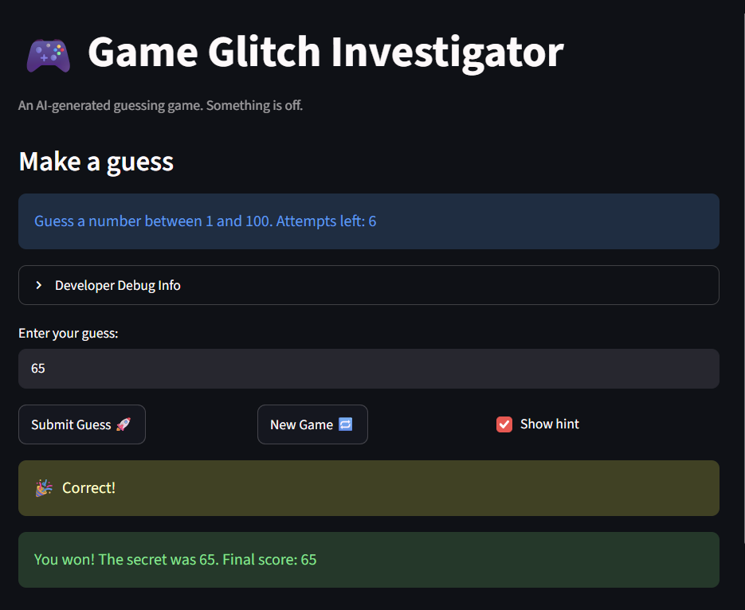

# 🎮 Game Glitch Investigator: The Impossible Guesser

## 🚨 The Situation

You asked an AI to build a simple "Number Guessing Game" using Streamlit.
It wrote the code, ran away, and now the game is unplayable. 

- You can't win.
- The hints lie to you.
- The secret number seems to have commitment issues.

## 🛠️ Setup

1. Install dependencies: `pip install -r requirements.txt`
2. Run the broken app: `python -m streamlit run app.py`

## 🕵️‍♂️ Your Mission

1. **Play the game.** Open the "Developer Debug Info" tab in the app to see the secret number. Try to win.
2. **Find the State Bug.** Why does the secret number change every time you click "Submit"? Ask ChatGPT: *"How do I keep a variable from resetting in Streamlit when I click a button?"*
3. **Fix the Logic.** The hints ("Higher/Lower") are wrong. Fix them.
4. **Refactor & Test.** - Move the logic into `logic_utils.py`.
   - Run `pytest` in your terminal.
   - Keep fixing until all tests pass!

## 📝 Document Your Experience

- [ ] The purpose of this app is to create a simple guessing game using streamlit for users to enjoy. When a new game is created, a secret number is chosen in the appropriate range (Easy: 1-20, Normal: 1-100, Hard: 1-100) and the user is given a set number of attempts to guess the secret number. Each guess returns a message directing the user twords this value. Attempts and scores are tracked for the user. 
- [ ] The bugs I found are as follows: 
The displayed # of attempts was incorrect, when a fresh game was started, the user would have 8 attempts remaining but the app would display only 7. This was due to the attempt counter being initialized as 1, not 0 (displayed st.session_state.attempts = 0, rather than st.session_state.attempts = 1) 
The high/low hints were reversed giving players incorrect instructions. For example the logic checked if guess > secret, and if so, displayed '"Too Low", "📈 Go HIGHER!"' which is incorrect, this applied vice versa as well. 
The new game button failed to reset game info such as score, status, and guess history. This is due to neither of these being included in the session state (only st.session_state.attempts = 0 and st.session_state.secret = random.randint(1,100) were tracked/initialized)
Selecting a difficulty level did not impact the valid range nor secret, now selecting a difficulty resets the secret. It was previously only selected from random.randint(1,100) regardless of valid range.
Invalid guesses and unusual inputs werent handled properly and string conversion of even guesses led to improper comparisions.
The game showed I had one attempt left when the game over message popped up, this was due to the fact the attempts left display updates before the guess count increments, hence it will always be one behind. 
- [ ] I applied fixes to all of these bugs. I first refractored my core logic from app.py into logic_utils.py to improve organization and testability. I then initialized attempts as 0 rather than 1 in order to display the correct number of attempts left. I edited the reversed hints in order to display the proper hints when users guess too high and too low. I updated the new game's functionality to properly reset the history, status, and score. I hard coded a new range for Hard difficulty, as it made no sense the range was 1-100 for normal, but 1-50 for hard, also when u select a difficulty, the secret resets and is randomly chosen between the hard coded range. Invalid guesses are now properly handled: decimals and rounded up, scientific notaion is converted to an integer, blanks and invalid characters are not accepted, and every compariosn is now made numerically rather then converting anything to strings. The attempts left display box is now an empty placeholder on lines 67, but is later re-drawn at the end of the submit box. This ensures its updated and drawn with the correct attmpts left value. 


## 📸 Demo Walkthrough

Describe your fixed game in numbered steps so a reader can follow along without watching a video:

1. Player starts a new game on normal difficulty, with the secret range being 1-100 and 8 attempts available 
2. The player enters a guess of 32. If the secret is 62, the game displays 'Too Low' and tells the player to guess higher and an attempt is used 
3. The player enters a guess of 70, since the secret is 62, the game will display 'Too High' and tells the player to guess lower
4. The player guesses 62, the game displays 'Correct!' and ends the game with a winning message
5. During the game, remaining attempts and score update correctly after each guess. Invalid inputs do not use attempts
5. The player can select 'New Game' to reset the attempts, game status, and score, allowing them to start a new 

**Screenshot** *(optional)*: <!-- Insert a screenshot of your fixed, winning game here --> 

## 🧪 Test Results


``` text tests/test_game_logic.py::test_winning_guess PASSED                                                     [  5%]
tests/test_game_logic.py::test_guess_too_high PASSED                                                    [ 11%]
tests/test_game_logic.py::test_guess_too_low PASSED                                                     [ 17%]
tests/test_game_logic.py::test_hints_point_toward_secret PASSED                                         [ 23%]
tests/test_game_logic.py::test_attempts_left_starts_at_full_limit PASSED                                [ 29%]
tests/test_game_logic.py::test_player_gets_all_attempts_before_losing PASSED                            [ 35%]
tests/test_game_logic.py::test_decimal_guesses_round_to_nearest_whole_number PASSED                     [ 41%]
tests/test_game_logic.py::test_halves_round_up PASSED                                                   [ 47%]
tests/test_game_logic.py::test_scientific_notation_is_accepted PASSED                                   [ 52%]
tests/test_game_logic.py::test_non_numbers_are_rejected PASSED                                          [ 58%]
tests/test_game_logic.py::test_blank_input_is_rejected PASSED                                           [ 64%]
tests/test_game_logic.py::test_out_of_range_guesses_are_rejected PASSED                                 [ 70%]
tests/test_game_logic.py::test_range_edges_are_accepted PASSED                                          [ 76%]
tests/test_game_logic.py::test_decimal_that_rounds_out_of_range_is_rejected PASSED                      [ 82%]
tests/test_game_logic.py::test_hints_compare_numbers_not_text PASSED                                    [ 88%]
tests/test_game_logic.py::test_even_attempt_hint_is_correct_in_app PASSED                               [ 94%]
tests/test_game_logic.py::test_invalid_input_does_not_use_an_attempt PASSED                             [100%]
```
```
============================================= 17 passed in 1.79s =============================================
```
## 🚀 Stretch Features

- [ ] [If you choose to complete Challenge 4, describe the Enhanced UI changes here — a screenshot is optional]
- I completed challenge 1 for stretch features. 
